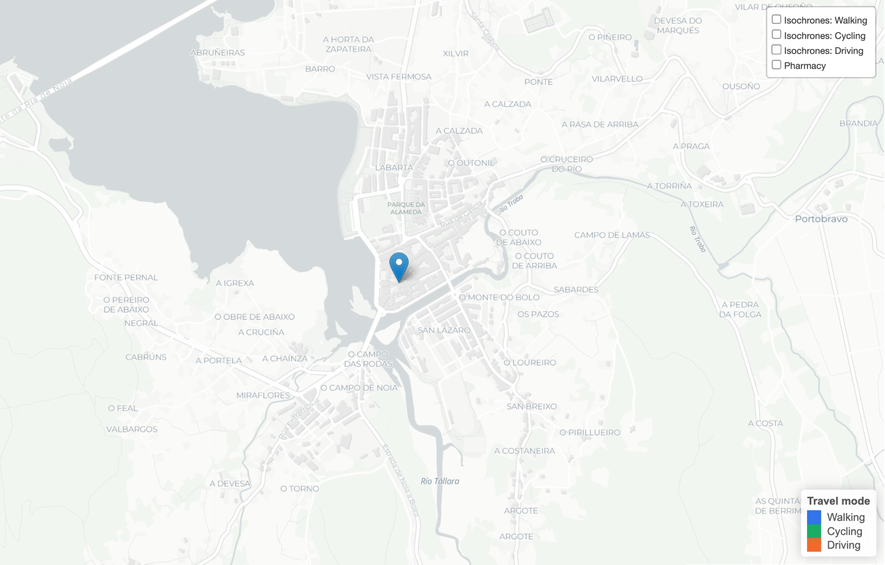
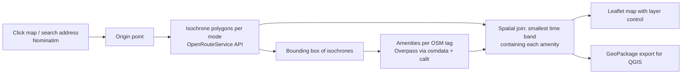

# Isochrone Accessibility App

An interactive R Shiny tool that answers spatial accessibility questions for non-technical users.

Click a point on the map (or search an address), pick travel modes and OpenStreetMap amenities, and the app draws travel time isochrones, overlays the amenities that fall inside them, and exports everything as a **QGIS-ready GeoPackage**.

I built it during my internship at Fundación RIA so that architects could run accessibility analyses for site and exhibition research without writing code or opening a GIS.


## Demo
Walking, cycling, and driving isochrones for Pharmacy accessibility in Portobravo

https://github.com/user-attachments/assets/7d2e55ba-4185-4426-8010-3a1833453aff



## Features

- **Two ways to set an origin:** click the map or geocode an address (OpenStreetMap Nominatim).
- **Isochrones for walking, cycling and driving**, computed with the [OpenRouteService](https://openrouteservice.org) API. Choose any combination of modes and up to 10 time thresholds (e.g. `5, 10, 15` minutes). Requests are checked against ORS's per-mode range limits.
- **Amenity overlay from OpenStreetMap:** 20 presets (schools, pharmacies, supermarkets, parks, bus stops, …) or any custom `key=value` OSM tag such as `amenity=veterinary`. 
- **Reachability attribute per amenity:** each amenity is tagged with the smallest time band that contains it, per mode (`walk_min`, `bike_min`, `drive_min`). 
- **Readable map:** one colour per mode, ring opacity scaled by travel time, a layer control to toggle each mode and each amenity type, optional name labels, and a "named amenities only" filter to cut duplicates.
- **One click export:** a single `.gpkg` with `isochrones`, `amenities` and `origin_point` layers, ready to drop into QGIS.

## How it works



| File | Role |
|---|---|
| [`app/app.R`](app/app.R) | Shiny UI (bslib sidebar layout) and reactive server logic: origin, isochrone and amenity state, map drawing, layer control, export. |
| [`app/helpers.R`](app/helpers.R) | Core logic, kept separate from the UI: `geocode_address()`, `parse_times()`, `clamp_times_for_profile()`, `get_isochrone()`, `fetch_amenities()`, `assign_time_bands()`. |

## Setup

**Requirements:** R ≥ 4.1 and a free OpenRouteService API key ([sign up](https://openrouteservice.org/dev/#/signup)). The `sf` package needs the system GDAL/GEOS/PROJ libraries; see the [sf installation notes](https://r-spatial.github.io/sf/#installing) if installation fails.

```r
install.packages(c("shiny", "bslib", "leaflet", "sf", "httr", "jsonlite", "osmdata", "callr"))
```

**Add your API key.** The key is read from the `ORS_API_KEY` environment variable and is never stored in the code.

```bash
cp .Renviron.example .Renviron   # then edit .Renviron and paste your key
```

Restart R from the project root so `.Renviron` is loaded (or open `isochrone-accessibility-app.Rproj` in RStudio), then run:

```r
shiny::runApp("app")
```

## Usage

1. **Set an origin** by clicking the map or searching an address.
2. **Enter isochrone times** in minutes, comma-separated (default `5, 10, 15`).
3. **Choose travel mode(s).**
4. **Pick amenities** from the presets, or type a custom OSM `key=value` tag.
5. Press **Generate map**, toggle layers as needed, then **Download .gpkg**.

The map opens on Santiago de Compostela, Galicia, but the app works anywhere OpenStreetMap and ORS have coverage.

## Notes and limitations

- It relies on free public services (ORS, Nominatim, Overpass), so it is subject to their rate limits and usage policies. It is meant for interactive, small-scale use rather than bulk analysis.
- Amenity completeness depends on OpenStreetMap coverage in the area.

## License

[MIT](LICENSE)

Map data © [OpenStreetMap](https://www.openstreetmap.org/copyright) contributors. Routing by [OpenRouteService](https://openrouteservice.org). Basemap © [CARTO](https://carto.com/attributions).
